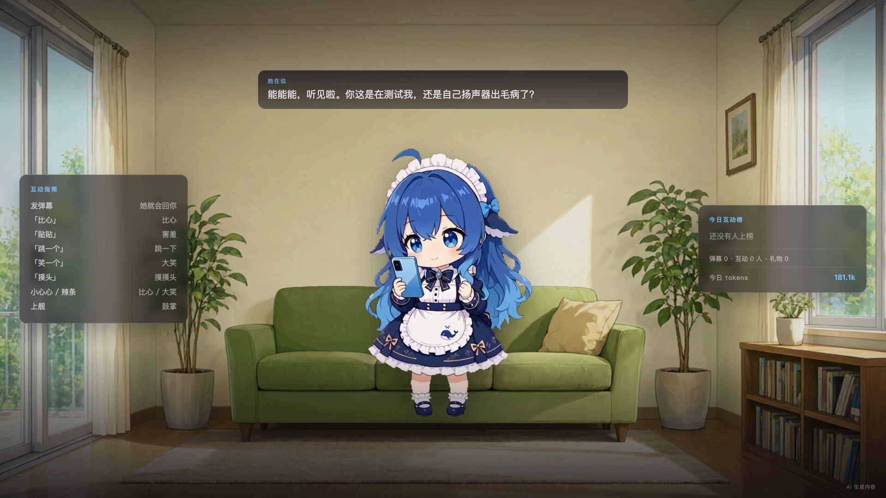

# 大肥鱼 · AI 直播

一个会自己上网、自己找事做、跟弹幕聊天的 Q 版 AI 主播。

弹幕进来 → 大脑回话 → 本机 TTS 出声 → 透明 Q 版形象落在客厅里 → OBS 推到 B 站。
整条链路都在本机，不依赖云端数字人、不依赖在线 TTS API。



## 这个仓库不包含什么

**大脑不在这里。** 角色的记忆、人格和 DeepSeek 调用在
[Hippocampus](https://github.com/yushui2022/Hippocampus)（海马体记忆系统）里，
本项目通过 WebSocket 连它的 `:6200`。

这样拆开的原因：记忆系统是通用的，直播只是它的一个出口。
换一个平台或换一个形象，大脑不用动。

## 结构

```text
弹幕 / 礼物
   │  POST :6220/comment  /gift
   ▼
stream/bridge.py :6220      去重 · 排队 · 限速 · 互动榜统计
   │  WS
   ▼
Hippocampus 大脑 :6200      记忆 + 人格 + DeepSeek（独立仓库）
   │  {type:"turn", say, expression, actions, looking_at}
   ▼
stream/stream.html :6210    表情 · 动作 · 字幕 · 互动指南 · 今日榜
   │  POST :6211/tts
   ▼
tts/server.py :6211         Qwen3-TTS（sohee / 8bit）
   │  WAV
   ▼
OBS 浏览器源 1920×1080  →  RTMP  →  B 站
```

| 目录 | 内容 |
| --- | --- |
| `stream/` | 直播画面（HTML/CSS/JS）、弹幕桥、场控面板、OBS 刷新 |
| `assets/small/` | 35 条透明 WebM 动作 |
| `assets/` | 客厅背景（白天 / 夜晚） |
| `tts/` | 本机 TTS 服务 |
| `taozi_chibi/` | 动作素材生成流水线（ComfyUI + MiniMax-H3） |
| `bilibili/` | 弹幕适配器 + 5000 粉以下的开播脚本 |
| `docs/LIVE.md` | 完整运行手册 |

## 快速开始

```bash
# 0) 大脑先起来（另一个仓库，需要 DEEPSEEK_API_KEY）
#    默认 ws://127.0.0.1:6200/ws

# 1) 直播侧依赖
python3 -m venv .venv
./.venv/bin/pip install -r stream/requirements.txt

# 2) TTS 依赖（Apple Silicon，mlx-audio）
python3 -m venv tts/.venv
./tts/.venv/bin/pip install -r tts/requirements.txt

# 3) 一键启动（语音 + 静态页 + 弹幕桥）
./start.sh

# 4) 打开
open http://127.0.0.1:6210/stream/stream.html
open http://127.0.0.1:6210/stream/control.html   # 场控
```

详细步骤、端口、环境变量见 [`docs/LIVE.md`](docs/LIVE.md)。

## 她会做什么

```text
待机      四套 idle 轮换，每三轮插一个随机小动作
说话      弹幕回复 → talk 动画 + 字幕 + TTS
表情      happy / angry / confused / smirk / shy / sad / laugh / sigh / surprised
动作      思考（托腮）· 点头 · 挥手 · 摇头 · 跳一下 · 伸懒腰 · 打哈欠 · 摸头 · 理头发
道具      摸鱼（手机）· 吃东西 · 看书，都是 掏出来 → 循环 → 收回去
自动上网  安静 20 秒后每 15 秒换一个页面，每 4 页嘟囔一句
休息      安静 100 秒后自己找点事做，有人说话先收好道具再开口
互动      发「比心 / 贴贴 / 跳一个 / 笑一个 / 摸头」会触发对应动作
礼物      小心心 → 比心，辣条 → 大笑，上舰 → 鼓掌
```

## 直播

- 画面源：`http://127.0.0.1:6210/stream/stream.html?audio=1`
- OBS 浏览器源必须勾选 **「通过 OBS 控制音频」**，否则声音只进系统扬声器，推流是静音的
- B 站第三方开播门槛是 5000 粉，低于这个数用 `bilibili/go_live.py` 走直播姬通道
- 海外 IP 会触发 `60045`，开播和推流都要走国内网络

## 素材

形象动画全部由本机 ComfyUI 生成，流程见 [`taozi_chibi/README.md`](taozi_chibi/README.md)。
所有动作统一几何：头宽 311 / 脚底 671 / 中心 683。

## 授权

- **代码**：MIT
- **形象素材**：CC BY-NC-SA 4.0，**禁止商用**，署名见 [`ASSETS.md`](ASSETS.md)
